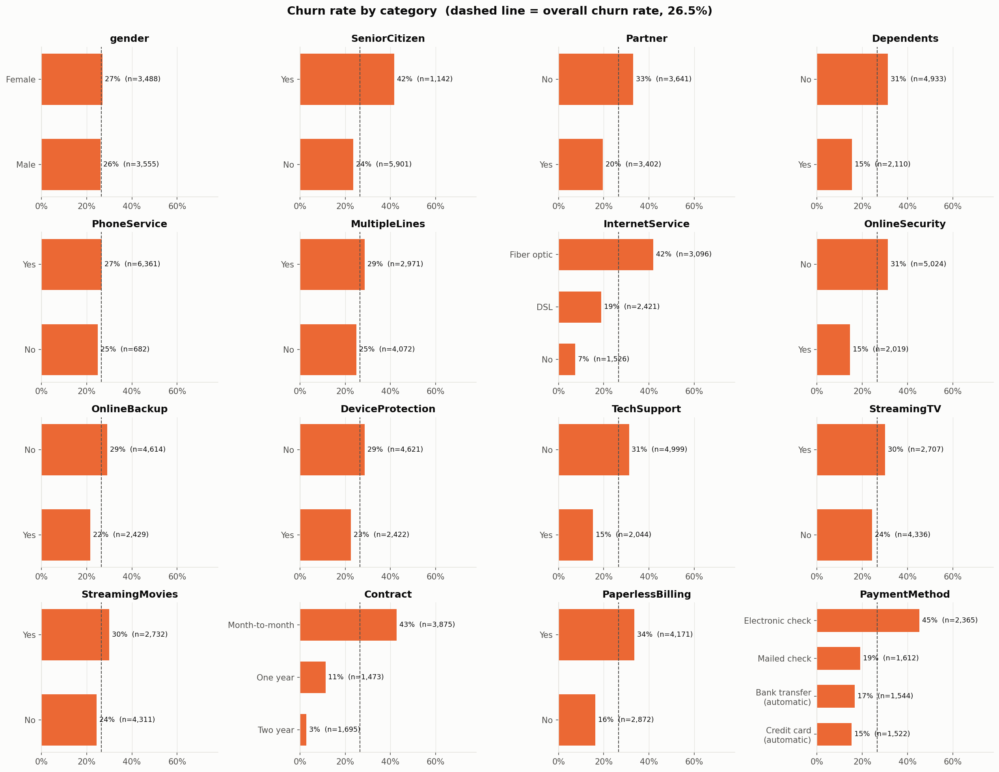
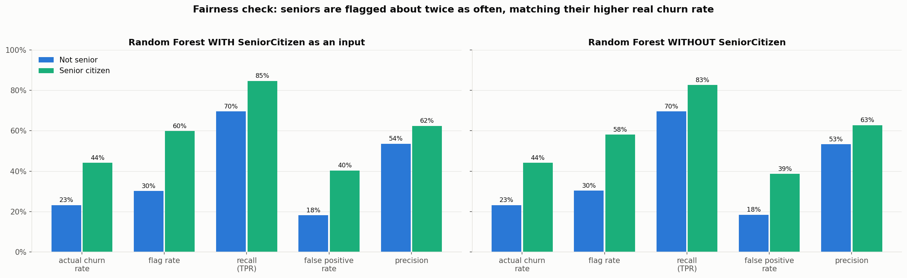

# MSCS 634 – Final Project: Advanced Data Mining for Data-Driven Insights and Predictive Modeling

**Deliverable 4: Final Insights, Recommendations, and Presentation**

**Authors:**
- Pranavi Balakulla
- Sandeep Reddy Banda
- Sowmya Cheruku
- Vineela Reddy Karnatakam

**Video presentation:** [add the link to your recorded video here]

---

## Repository Contents

```
MSCS_634_Project/
├── MSCS_634_Project.ipynb               # Consolidated notebook: all code from Deliverables 1–4 with comments
├── README.md                            # This file
├── MSCS_634_Final_Project_Report.docx   # Comprehensive written report (Word)
├── MSCS_634_Final_Project_Report.pdf    # Same report as PDF
├── MSCS_634_Final_Presentation.pptx     # Slides for the video presentation (with speaker notes)
├── MSCS_634_Final_Presentation.pdf      # Same slides as PDF
├── Presentation_Script.md               # Timed script for the 5–7 minute video, split by presenter
├── requirements.txt                     # Python packages needed to run the notebook
├── Telco-Customer-Churn.csv             # Raw dataset
├── telco_churn_cleaned.csv              # Cleaned dataset written by the notebook
└── Images/                              # All 26 figures (p1_ = Part 1, p2_ = Part 2, p3_ = Part 3, p4_ = Part 4)
```

**To run:** `pip install -r requirements.txt`, open `MSCS_634_Project.ipynb` in Jupyter and choose *Run All*
(about 2 minutes). Every number and figure in the report is regenerated.

---

## Dataset Summary

The **IBM Telco Customer Churn** dataset ([Kaggle](https://www.kaggle.com/datasets/blastchar/telco-customer-churn))
describes **7,043 customers** of a fictional telecom company with **21 attributes**: demographics, services bought,
contract and billing details, tenure, monthly and total charges. The target `Churn` shows whether the customer left
in the last month; **26.5%** did.

**Why we chose it:** it supports every technique in the project (continuous targets for regression, a churn label for
classification, behaviour measures for clustering, Yes/No service flags for association rules), it has real
data-quality problems to clean, and churn has clear business value.

---

## Project Steps

| Part | Deliverable | What we did |
|---|---|---|
| 1 | Data collection, cleaning and EDA | Found 11 hidden blank values (imputed $0, since all had tenure 0), kept 22 look-alike rows (distinct customers), made encodings consistent, merged redundant categories, checked for noise (0 outliers), binned tenure, and explored churn drivers with 9 charts |
| 2 | Regression | Predicted customer **lifetime revenue** without `tenure` (avoiding target leakage), engineered 11 features, and compared 5 models with 5-fold CV and a test set |
| 3 | Classification, clustering, association rules | 6 churn classifiers with **GridSearchCV** tuning; **K-Means** segmentation (k = 4); **Apriori / FP-Growth** rule mining |
| 4 | Final insights and ethics | Consolidated notebook, **fairness audit** by age group and gender, privacy and bias review, recommendations, report and presentation |

---

## Major Findings

| Technique | Headline result |
|---|---|
| EDA | Month-to-month customers churn at 42.7% vs 2.8% on two-year contracts; first-year churn is 47%; fiber optic 42%; electronic check 45% |
| Regression | Engineered features lifted linear R² from 0.744 to 0.792; **Ridge** recommended (test R² 0.800, tied with Gradient Boosting at 0.801) |
| Classification | **Random Forest** is best: F1 0.636, ROC-AUC 0.843, catches 74% of churners. Tuning raised Decision Tree F1 from 0.499 to 0.621 |
| Clustering | 4 segments with churn from **4%** (Loyal, low cost) to **47%** (New, high spend, which holds 61% of all churners) |
| Association rules | {Fiber optic, first 12 months} ⇒ Churn: **70%** confidence, lift 2.63. {Two-year contract} ⇒ Stay: **97%** |
| Fairness | Seniors are flagged 60% vs 30% (their real churn is 44% vs 23%). Removing `SeniorCitizen` barely changes results (F1 0.636 → 0.633) because other features act as **proxies** |





### Recommendations

1. Score customers monthly and rank them by **revenue at risk** (churn probability × predicted value).
2. Run a **12-month onboarding programme**, because the first year is when churn peaks.
3. Offer incentives to move month-to-month customers to **longer contracts**.
4. Review **fiber-optic pricing and service quality**.
5. Encourage **automatic payment** instead of electronic checks.
6. Bundle **protective add-ons** (OnlineSecurity / TechSupport) for new internet customers.
7. Tailor retention spend by **segment**.
8. **Deploy responsibly:** no age or gender inputs, monitor outcomes by group, and use scores only for helpful offers.

### Ethical considerations (summary)

- **Privacy:** the data is fictional, and the customer ID was never used as a model input. A real deployment would need
  data minimisation, access control and GDPR/CCPA compliance.
- **Fairness:** we audited the churn model by age group and gender. Removing a sensitive column is not enough, so
  outcomes must be monitored by group.
- **Bias:** the data comes from one company at one point in time, tenure is censored, and important variables such as
  satisfaction and network quality are missing. Associations are not causes, so each action should be A/B tested.

### Future improvements

Survival analysis, cost-based decision thresholds, uplift modeling, richer data, SHAP explanations and fairness
monitoring.
